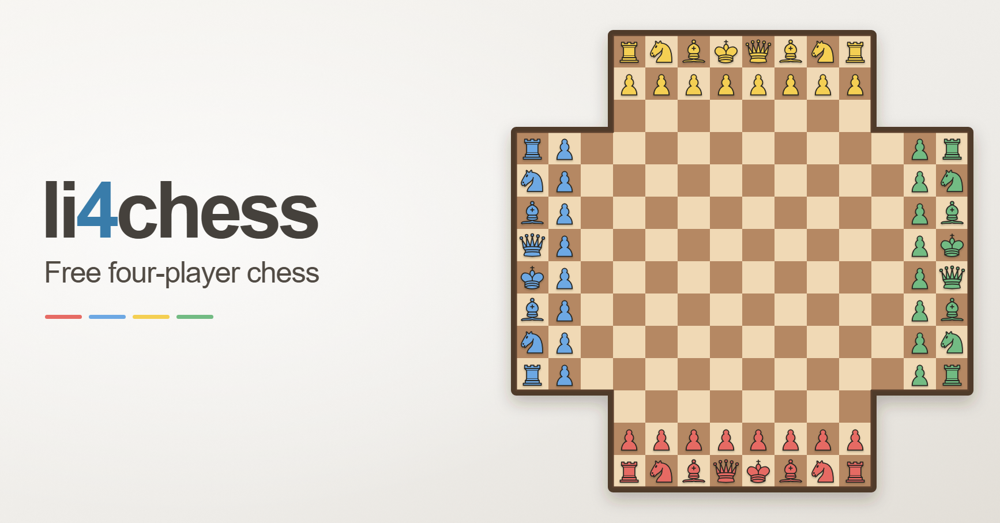

# li4chess

Free, ad-free, open-source four-player chess. Play against the computer or share
one device with friends, right in your browser. Inspired by [lichess](https://lichess.org).

[](https://github.com/ariesyous/li4chess/actions/workflows/ci.yml)
[](LICENSE)

**[Play now](https://li4chess.org/)** · [Run locally](#run-locally) ·
[Contribute](#contributing) · [Roadmap](ROADMAP.md)

[](https://li4chess.org/)

## Play your way

- **Jump straight in.** Choose **Play against computers** to play Red against
  three level-3 CPUs, or **Customize game** to mix human and CPU seats. All four
  seats can be computers, too.
- **Choose your challenge.** Five CPU difficulty levels run in your browser,
  using the Tetrarch advisory hybrid with a native fallback. li4chess validates
  every move and determines all rules and results.
- **Follow the action.** Legal-move highlights, check indicators, optional board
  rotation, move history and a points ledger help you keep track of four armies.
- **Pick up where you left off.** Games autosave in this browser. Resume from
  setup, or export and import validated replay files for portable backups.
- **Play comfortably.** A responsive board, keyboard controls, optional
  piece-owner letters and text labels supplement the four player colors.
- **Go again.** **Play again** starts a rematch with the same seats and difficulty
  levels; **Change settings** returns to setup with those choices retained.

The public site supports local and CPU play. Human players share one device.
Private multiplayer is available for local development; hosted multiplayer,
accounts, matchmaking and ratings are deferred.

### A quick rules primer

Four armies take turns **Red → Blue → Yellow → Green** on a cross-shaped board
with 160 playable squares. Final points determine placements, including those of
eliminated players, and tied scores share a place.

Castling, en passant and automatic queen promotion are supported. Checkmate and
stalemate resolve when the affected player's turn arrives; their pieces remain
as passive blockers that can be captured for zero points. Resignation after the
opening guard leaves a king that moves automatically on its regular turn.

See the [standard FFA rules specification](docs/rules-spec.md) for scoring,
endings and special cases. The implemented ruleset is `li4chess-ffa-standard-v1`.

### Controls and saves

Click a piece, then a highlighted destination. With a keyboard, **Tab** enters
the board, **arrow keys** navigate, **Enter/Space** select or move, and **Escape**
clears the selection.

**More game tools** contains manual saving, replay import/export, reset and
simulated timeout. The browser keeps one local save; starting a new game or a
rematch replaces it. Export a replay first to keep a portable copy.

## Run locally

Use **Node.js 24+** and **pnpm 10.33.0** (pinned in `package.json`). From the
repository root:

```sh
pnpm install --frozen-lockfile
pnpm dev
```

Open [localhost:5173/li4chess/](http://localhost:5173/li4chess/).

### Checks

```sh
pnpm lint                          # TypeScript checks
pnpm test                          # Unit tests
pnpm build                         # Production build
pnpm --filter @li4chess/web exec playwright install chromium
pnpm --filter @li4chess/web test:e2e # Browser tests; starts its own Vite server
```

[CI](.github/workflows/ci.yml) runs these checks on pull requests and pushes to
`main`, plus production-preview checks for the bundled CPU runtime and homepage.
To run those preview checks locally after building:

```sh
pnpm --filter @li4chess/web test:e2e:production
```

### Deployment

The [GitHub Pages workflow](.github/workflows/deploy-pages.yml) publishes
`apps/web/dist` from `main`. It uses the base path supplied by Pages: `/` for
[li4chess.org](https://li4chess.org/). Local builds default to `/li4chess/`.
See the [release notes and rollback procedure](docs/l1-release.md).

Homepage metadata lives in [`apps/web/index.html`](apps/web/index.html); crawl
files live in [`apps/web/public`](apps/web/public). Keep the canonical URL,
social URLs and sitemap in sync if the public domain changes.

## Project structure

TypeScript, React and Vite, organized with pnpm workspaces and Turborepo.

| Location | Responsibility |
| --- | --- |
| [`apps/web`](apps/web) | Browser app, seat setup, saves and CPU turn scheduling. |
| [`packages/engine`](packages/engine) | Pure rules, legal moves, scoring and game results. |
| [`packages/ui-kit`](packages/ui-kit) | Board, SVG pieces and theme. |
| [`packages/bot`](packages/bot) | Native CPU search, frozen classic bot and experimental search. |
| [`packages/tetrarch-engine`](packages/tetrarch-engine) | Tetrarch WASM adviser, runtime assets and hybrid integration. |
| [`packages/protocol`](packages/protocol) | Validated state/replay formats, canonical hashes and multiplayer schemas. |
| [`packages/arena`](packages/arena) | Seeded tournaments, replay validation and benchmarks. |
| [`apps/worker`](apps/worker) | Static Assets runtime and opt-in local private multiplayer. |
| [`packages/game-room`](packages/game-room) | Guest/lobby service, authoritative rooms, clocks and recovery. |
| [`packages/persistence`](packages/persistence) | D1 migrations, command/event history and replay reconstruction. |
| [`packages/architecture-spike`](packages/architecture-spike) | Preserved local multiplayer architecture prototype. |

[`useLocalGame`](apps/web/src/game/useLocalGame.ts) coordinates local play and CPU
turns. The rules engine owns legality and scoring; game state is immutable and
JSON-shaped.

## Contributing

Bug reports, usability feedback and focused fixes are welcome. Use
[GitHub Issues](https://github.com/ariesyous/li4chess/issues) to report a problem;
include steps to reproduce it, your browser and a replay file when useful.

Before making a change, read [AGENTS.md](AGENTS.md) for repository conventions
and validation requirements. The [roadmap](ROADMAP.md) describes product scope;
[project state](docs/project-state.md) records current work and accepted decisions.
The released local/CPU game is in maintenance, with no promised feature schedule.

For code changes, run lint, unit tests and the build. Run browser tests when
browser behavior is affected, including rules or CPU changes. For documentation
changes, check local links, referenced commands and `git diff --check`.

### Deeper documentation

- **Rules and replays:** [standard FFA contract](docs/rules-spec.md) and
  [protocol package](packages/protocol).
- **Browser CPU:** [Tetrarch integration, resource tiers and recovery](docs/engine/tetrarch-browser-default.md).
- **Bot research:** [arena methodology](docs/engine/arena-methodology.md),
  [production reconciliation](docs/engine/reconciliation.md) and
  [experiment ledger](docs/engine/experiments.md). Preserve frozen classic sources
  and archived evidence; label new measurements with their code and environment.
  Replay-validate games and treat ply-capped games as unfinished. Historical
  timings and small comparisons do not establish current performance or strength.
- **Local private multiplayer:** [setup](apps/worker/README.md#explicit-local-authenticated-multiplayer),
  [wire contract](docs/multiplayer-v1.md) and
  [deferred hosted handoff](docs/m3-hosted-handoff.md). The
  [extended validation workflow](.github/workflows/validate-multiplayer.yml)
  covers Worker/D1/multiplayer campaigns separately from default Pages CI.

## License and credits

li4chess is licensed under **GNU AGPL v3 only**. See [LICENSE](LICENSE).

The interface takes inspiration from Lichess. Chess pieces are adapted from
Colin M. L. Burnett's Cburnett SVG set under GPL-2.0-or-later. See
[third-party notices](THIRD_PARTY_NOTICES.md) for asset sources, licenses and
modifications, including the Tetrarch runtime.
